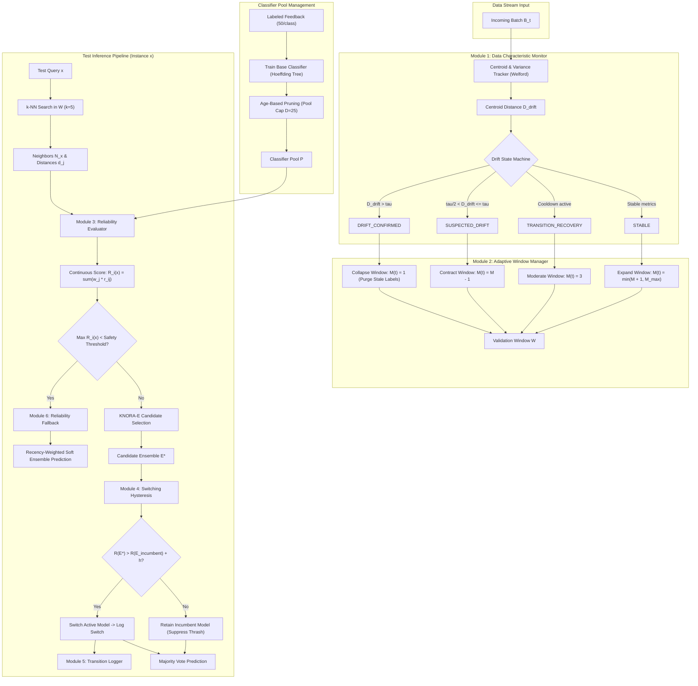

# DART-X: Drift-Aware Reliability and Transition Framework
## Algorithmic Specification, Mathematical Formulation, and Architecture

**Framework Name:** DART-X (Drift-Aware Reliability and Transition Framework)  
**Base Lineage:** Dynamic Selection Based Drift Handler (Dynse, Almeida et al., 2018)  
**Author / Research Project:** University Assignment — Data Warehousing and Data Mining  
**Date:** 2026-11-18  

---

## 1. Architectural Philosophy and Problem Statement

Dynamic Classifier Selection (DCS) operates under the principle that different classifiers possess local competence in distinct subregions of the feature space. In non-stationary data streams, concept drift shifts class boundaries ($P(y \mid x)$) and feature distributions ($P(x)$) over time.

While the original Dynse framework introduced a time-dependent sliding validation window $W$ to adapt DCS for streaming data, it exhibits critical vulnerabilities:
1. **Rigid Window Sizing ($M$):** Dynse uses a fixed window size $M$ ($M=4$ for real drift, $M=32$ for virtual drift). When abrupt drift occurs, $W$ remains polluted with pre-drift instances for several batches, degrading neighborhood competence estimation.
2. **Binary Competence Scoring:** Dynse (KNORA-E) measures competence by discrete hit counts ($hitMapping \ge k - l$). It ignores classifier margin confidence, probability calibration, and neighbor distance.
3. **Model Thrashing:** Under borderline ambiguity, independent per-instance DCS causes rapid, erratic switching between candidate models without regard to model consistency or switching inertia.
4. **Lack of Fallback Strategy:** When all models in pool $P$ have poor competence on a shifted region, KNORA-E continually relaxes slack $l$ until forcing the selection of uncalibrated, low-confidence models.

**DART-X** resolves these fundamental limitations through six synergistic modules.



---

## 2. Mathematical Formulations of DART-X Modules

### 2.1 Module 1: Data Characteristic & Drift Monitoring
Let $B_t = \{x_1, x_2, \dots, x_{N_t}\}$ be the incoming batch of feature vectors at time step $t$ in $\mathbb{R}^d$ ($d = 59$ for LBP).

1. **Streaming Centroid Update:**
   $$\mu_t = \frac{1}{N_t} \sum_{i=1}^{N_t} x_i$$

2. **Centroid Divergence (Drift Magnitude):**
   $$D_{\text{drift}}(t) = \|\mu_t - \mu_{t-1}\|_2 = \sqrt{\sum_{j=1}^d (\mu_{t, j} - \mu_{t-1, j})^2}$$

3. **Batch Error Jump:**
   $$\Delta \epsilon_t = \epsilon_t - \epsilon_{t-1}$$
   where $\epsilon_t = \frac{FP_t + FN_t}{N_t}$ is the observed error rate of the previous step.

4. **Drift State Transition Function:**
   $$S_t = \begin{cases}
   \text{TRANSITION\_RECOVERY}, & \text{if } \text{cooldown} > 0 \\
   \text{DRIFT\_CONFIRMED}, & \text{if } D_{\text{drift}}(t) \ge \tau_{\text{drift}} \lor \Delta \epsilon_t \ge \theta_{\text{error}} \\
   \text{SUSPECTED\_DRIFT}, & \text{if } D_{\text{drift}}(t) \ge 0.5 \tau_{\text{drift}} \lor \Delta \epsilon_t \ge 0.5 \theta_{\text{error}} \\
   \text{STABLE}, & \text{otherwise}
   \end{cases}$$
   *Default Parameters:* $\tau_{\text{drift}} = 0.08$, $\theta_{\text{error}} = 0.15$, cooldown period = 2 batches.

---

### 2.2 Module 2: Adaptive Validation-Window Management
In contrast to Dynse's static window, DART-X modulates validation window size $M(t) \in [M_{\min}, M_{\max}]$ (in batches):

$$M(t) = \begin{cases}
M_{\min} = 1, & \text{if } S_t = \text{DRIFT\_CONFIRMED} \\
\max(M_{\min}, M(t-1) - 1), & \text{if } S_t = \text{SUSPECTED\_DRIFT} \\
\min(3, M(t-1) + 1), & \text{if } S_t = \text{TRANSITION\_RECOVERY} \\
\min(M_{\max}, M(t-1) + 1), & \text{if } S_t = \text{STABLE}
\end{cases}$$

*Rationale:* When sensor or environment drift strikes (e.g. `UFPR04` $\to$ `UFPR05` or `UFPR05` $\to$ `PUCPR`), pre-drift validation samples in $W$ reflect obsolete decision boundaries. Collapsing $M(t)$ to $1$ purges contaminated samples within exactly one batch, allowing rapid post-drift recovery.

---

### 2.3 Module 3: Reliability-Based Classifier Evaluation
For query instance $x$, let $N_x = \{x_1, x_2, \dots, x_k\} \subset W$ be its $k$ nearest neighbors with distances $d_j = \|x - x_j\|_2$.

1. **Normalized Distance Weights:**
   $$w_j = \frac{\frac{1}{d_j + \epsilon}}{\sum_{m=1}^k \frac{1}{d_m + \epsilon}}, \quad \epsilon = 10^{-5}$$

2. **Continuous Neighbor Calibration Score:**
   For classifier $C_i \in P$ on neighbor $x_j$ with true class $y_j \in \{0, 1\}$:
   $$r_{ij} = P(y = y_j \mid x_j, C_i)$$
   where $P(y = y_j \mid x_j, C_i)$ is the posterior class probability produced by $C_i$. If $C_i$ misclassifies $x_j$, $r_{ij} < 0.5$; if $C_i$ correctly classifies with high confidence, $r_{ij} \to 1.0$.

3. **Composite Local Reliability:**
   $$R_i(x) = \sum_{j=1}^k w_j \cdot r_{ij}$$
   $R_i(x) \in [0, 1]$ represents the calibrated reliability of classifier $C_i$ for query $x$.

---

### 2.4 Module 4: Switching Hysteresis
Let $C_{\text{incumbent}}$ be the classifier selected for the immediately preceding test instance. Let $C^* = \arg\max_{C_i \in E^*} R_i(x)$ be the top candidate classifier.

To prevent rapid, unhelpful model oscillation on boundary samples:
$$\text{Active Classifier } C_{\text{active}} = \begin{cases}
C^*, & \text{if } C_{\text{incumbent}} \notin P \\
C^*, & \text{if } R(C^*, x) > R(C_{\text{incumbent}}, x) + h \\
C_{\text{incumbent}}, & \text{otherwise (Switch Suppressed)}
\end{cases}$$
*Default Hysteresis Margin:* $h = 0.04$ ($4\%$ reliability gain requirement).

---

### 2.5 Module 5: Model Transition Logging
Every instance evaluation records the transition tuple:
$$\mathcal{T}_t = \langle t, \text{ID}(C_{\text{from}}), \text{ID}(C_{\text{to}}), \Delta R, \text{Status} \rangle$$
where $\text{Status} \in \{\text{SWITCHED}, \text{SUPPRESSED}, \text{FALLBACK}\}$.

This provides an audit trail to quantify:
- **Switching Frequency:** $f_{\text{switch}} = \frac{N_{\text{switches}}}{N_{\text{instances}}}$
- **Suppression Ratio:** $\rho_{\text{suppressed}} = \frac{N_{\text{suppressed}}}{N_{\text{switches}} + N_{\text{suppressed}}}$

---

### 2.6 Module 6: Reliability Fallback Mechanism
If the maximum candidate reliability across all models in pool $P$ drops below a safety threshold:
$$\max_{C_i \in P} R_i(x) < \theta_{\text{safety}} \quad (\theta_{\text{safety}} = 0.35)$$
KNORA-E relaxation is bypassed. Instead, DART-X triggers an **Exponential Recency-Weighted Fallback Ensemble**:
$$\hat{y}(x) = \arg\max_{c} \sum_{i=1}^{|P|} \alpha_i \cdot P(y = c \mid x, C_i)$$
where $\alpha_i = \exp\left(\frac{i}{|P|}\right)$ gives highest weight to the freshest models trained on the most recent batches.

---

## 3. Algorithmic Pseudocode

```
Algorithm: DART-X Streaming Adaptive Classification Lifecycle

Input: Stream of daily batches {B_1, B_2, ..., B_82}
Parameters: Train budget N=100 (50 pos, 50 neg), Pool cap D=25,
            k=5, Hysteresis h=0.04, Safety theta=0.35

Initialize: Pool P <- empty, Window W <- empty, M <- 4, Incumbent <- null

For each Day t = 1 to 82:
    // 1. Supervised Training Phase
    If t == 1:
        Sample 50 pos and 50 neg from Day 1 -> B_train
    Else:
        Sample 50 pos and 50 neg from Day t-1 -> B_train
    
    W <- W U B_train
    Train new Hoeffding Tree C_t on B_train
    If |P| >= D: Evict oldest classifier from P (Age Pruning)
    P <- P U {C_t}
    
    // Update competence map for C_t on all w in W
    For each w in W:
        Evaluate C_t(w) and store posterior P(y_w | w, C_t)
        
    // 2. Testing Phase on All Instances of Day t
    Initialize daily metrics: TP=0, TN=0, FP=0, FN=0
    
    For each test instance x in Day t:
        Find k-nearest neighbors N_x in W with distances d_j
        
        // Reliability Evaluation
        Compute R_i(x) for all C_i in P using distance-weighted posteriors
        maxR <- max_{C_i} R_i(x)
        
        If maxR < theta_safety:
            pred <- FallbackEnsemble(x, P)
        Else:
            E_candidates <- KNORA-E(N_x, P, l=0)
            
            // Switching Hysteresis
            C_best <- argmax_{C in E_candidates} R_i(x)
            If Incumbent != null and Incumbent in P:
                If R(C_best, x) > R(Incumbent, x) + h:
                    Incumbent <- C_best
                    LogTransition(SWITCHED)
                Else:
                    LogTransition(SUPPRESSED)
            Else:
                Incumbent <- C_best
                LogTransition(INITIALIZED)
                
            pred <- Incumbent.predict(x)
            
        Update confusion matrix with pred vs. true class y_x
        
    // 3. Post-Batch Monitoring & Window Adaptation
    Compute batch error rate epsilon_t = (FP + FN) / |Day t|
    Update centroid mu_t and drift magnitude D_drift = ||mu_t - mu_{t-1}||_2
    state <- UpdateDriftStateMachine(D_drift, epsilon_t)
    M <- AdaptiveWindowManager.updateWindowSize(state, D_drift)
    
    // Evict expired instances from W to maintain |W| <= M * N
    While |W| > M * N:
        Remove oldest batch from W
        Update k-NN search index
```

