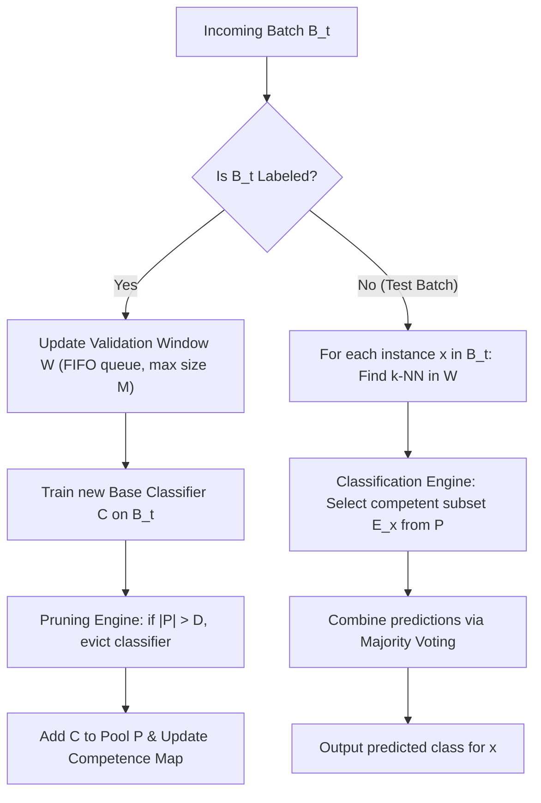

# DART-X — Phase 1: Repository Inspection, Environment Setup & Dataset Verification

**Project:** DART-X (Drift-Aware Reliability and Transition Framework)  
**Primary Baseline Paper:** *Adapting Dynamic Classifier Selection for Concept Drift* (Almeida, Oliveira, Britto Jr., & Sabourin, *Expert Systems with Applications*, 2018)  
**Baseline Repository:** `https://github.com/paulorla/dynse`  
**Inspection Date:** 2026-11-18  

---

## 1. Repository Verification

- **Repository Origin:** `https://github.com/paulorla/dynse.git`
- **Primary Clone Location:** `~/Documents/DART-X/original-dynse` and workspace copy `./original-dynse`
- **Active Git Commit:** `e9aa2343d579287f463a33b8c100e357af4db76c` (origin/master, origin/HEAD)
  - Commit message: *"Alterado para versão 2019-05 do MOA. Correções no POM. Pequenas correções nos paths estáticos presentes em algumas classes"*
- **Branch Inspected:** `master` (and remote branch `origin/RafaelGranza-PKLotTestBed`)
- **Repository Integrity:** Unmodified. All source files, configuration files (`.classpath`, `.project`, `pom.xml`), and sample files remain identical to the upstream repository.
- **Licensing:** GNU General Public License v3.0 (`license.txt` present in root).

---

## 2. Source-Code Architecture & Directory Layout

The original codebase is organized as a standard Maven project within the subfolder `original-dynse/dynse`:

```
original-dynse/
├── license.txt
├── .gitignore
├── RemoteSystemsTempFiles/
└── dynse/
    ├── pom.xml
    ├── .classpath
    ├── .project
    └── src/
        ├── test/java/
        │   └── br/ufpr/dynse/dynse/
        │       └── AppTest.java
        └── main/java/br/ufpr/dynse/
            ├── Main.java
            ├── classificationengine/
            │   ├── IClassificationEngine.java
            │   ├── KnoraEliminateClassificationEngine.java
            │   ├── KnoraUnionClassificationEngine.java
            │   ├── KnoraUnionWeightedClassificationEngine.java
            │   ├── OLAClassificationEngine.java
            │   ├── LCAClassificationEngine.java
            │   ├── APrioriClassificationEngine.java
            │   └── APosterioriClassificationEngine.java
            ├── classifier/
            │   ├── DynseClassifier.java
            │   ├── MajorityVoting.java
            │   ├── WeightedMajorityVoting.java
            │   ├── competence/
            │   │   ├── IClassifierCompetence.java
            │   │   ├── IMultipleClassifiersCompetence.java
            │   │   ├── ClassifierCompetence.java
            │   │   └── MultipleClassifiersCompetence.java
            │   └── factory/
            │       ├── AbstractClassifierFactory.java
            │       ├── AbstractDynseFactory.java
            │       ├── RealConceptDriftDynseFactory.java
            │       ├── VirtualConceptDriftDynseFactory.java
            │       ├── HoeffdingTreeFactory.java
            │       └── NaiveBayesFactory.java
            ├── concept/
            │   └── Concept.java
            ├── constant/
            │   └── Constants.java
            ├── core/
            │   ├── AbstractDynse.java
            │   ├── StreamDynse.java
            │   ├── ConceptMeasuredAbstractClassifier.java
            │   └── UFPRLearningCurve.java
            ├── dataset/converter/
            │   └── GaussianElwellPolikarConverter.java
            ├── evaluation/
            │   ├── EvaluatePeriodicHeldOutTestUFPR.java
            │   ├── EvaluateInterleavedChunksUFPR.java
            │   └── GaussianTestUFPR.java
            ├── exception/
            │   └── StatisticDoesNotExistException.java
            ├── generator/
            │   ├── ConceptBasedDriftGenerator.java
            │   ├── PxDriftGenerator.java
            │   ├── SeaDriftGenerator.java
            │   └── StaggerDriftGenerator.java
            ├── instance/
            │   ├── ConceptInstance.java
            │   └── InstanceComparator.java
            ├── neighborsearch/
            │   ├── LinearClassNNSearch.java
            │   └── LinearIndexNNSearch.java
            ├── pruningengine/
            │   ├── IPruningEngine.java
            │   ├── AbstractDefaultPruningEngine.java
            │   ├── AgeBasedPruningEngine.java
            │   ├── AccuracyBasedPruningEngine.java
            │   ├── NoPrunePruningEngine.java
            │   └── DynseClassifierPruningMetrics.java
            ├── testbed/
            │   ├── MultipleExecutionsTestbed.java
            │   ├── StaggerTestbed.java
            │   ├── SeaConceptsTestbed.java
            │   ├── CheckerboardTestbed.java
            │   ├── GaussianTestbed.java
            │   ├── NebraskaWeatherTestBed.java
            │   ├── ForestCoverTypeTestBed.java
            │   ├── LettersTestbed.java
            │   └── NistTestbed.java
            └── util/
                ├── AccuracyUtils.java
                ├── AttributesUtils.java
                ├── InstancesUtils.java
                └── UFPRLearningCurveUtils.java
```

### Module Responsibilities:
1. **`core/`**: Defines the streaming lifecycle. `AbstractDynse` holds pool structures and validation accumulators. `StreamDynse` extends MOA's `AbstractClassifier` to handle incremental chunking, updating validation window instances, re-indexing $k$-NN, and updating classifiers.
2. **`classificationengine/`**: Implements dynamic selection strategies (KNORA-E, KNORA-U, KNORA-UW, OLA, LCA, A Priori, A Posteriori) evaluating neighborhood competence.
3. **`pruningengine/`**: Implements pool bounding strategies (`AgeBasedPruningEngine` evicting the oldest model when $|P| > D$; `AccuracyBasedPruningEngine` evicting the lowest performer on $W$).
4. **`classifier/factory/`**: Standardizes base learner initialization (Hoeffding Tree or Naive Bayes) and default configuration wiring (`RealConceptDriftDynseFactory` with $M=4$; `VirtualConceptDriftDynseFactory` with $M=32$).
5. **`testbed/`**: Encapsulates experimental routines for synthetic and real-world datasets across multiple random seeds.

---

## 3. Original Algorithm Explanation (Dynse Framework)

Dynse operates on a stream of incoming batches $\{B_1, B_2, \dots, B_t\}$. The exact mapping of the paper's Algorithm 1 to Java source code is detailed below:



### 3.1 Classifier Pool Creation
- **Source:** [`AbstractDynse.java#L94-L128`](file:///Users/thaladasrinivas/Desktop/dwdm(main)/original-dynse/dynse/src/main/java/br/ufpr/dynse/core/AbstractDynse.java#L94-L128) and [`StreamDynse.java#L207-L221`](file:///Users/thaladasrinivas/Desktop/dwdm(main)/original-dynse/dynse/src/main/java/br/ufpr/dynse/core/StreamDynse.java#L207-L221).
- Training instances are buffered in `trainInstancesAccumulator` until reaching `numMinInstancesTrainClassifier`.
- `classifierFactory.buildClassifier(trainBatch)` trains a new base model (default: `moa.classifiers.trees.HoeffdingTree`).
- The model is wrapped in `DynseClassifier<DynseClassifierPruningMetrics>` storing creation time, usage counters, and concept tags.
- If classification is demanded before a batch is full, `trainClassifierIncompleteBatch()` creates a provisional classifier to ensure non-empty pool status.

### 3.2 Local Classifier Competence Evaluation
- **Source:** [`StreamDynse.java#L119-L150`](file:///Users/thaladasrinivas/Desktop/dwdm(main)/original-dynse/dynse/src/main/java/br/ufpr/dynse/core/StreamDynse.java#L119-L150) and [`KnoraEliminateClassificationEngine.java#L54-L86`](file:///Users/thaladasrinivas/Desktop/dwdm(main)/original-dynse/dynse/src/main/java/br/ufpr/dynse/classificationengine/KnoraEliminateClassificationEngine.java#L54-L86).
- Dynse maintains an inverted competence lookup table `classifiersMapping: Map<Instance, IMultipleClassifiersCompetence>`.
- For query instance $x$, the system queries the nearest neighbor index (`nnSearch.kNearestNeighbours(x, k)`).
- For each neighbor $x_j \in N_x$, the pre-computed competence record in `classifiersMapping` is queried to tabulate accuracy or posterior probabilities across candidate classifiers in $P$.

### 3.3 Validation Window Mechanism ($W$)
- **Source:** [`StreamDynse.java#L99-L107`](file:///Users/thaladasrinivas/Desktop/dwdm(main)/original-dynse/dynse/src/main/java/br/ufpr/dynse/core/StreamDynse.java#L99-L107).
- Maintained as a double-ended queue `accuracyEstimationInstances` of capacity $M \times \text{batchSize}$.
- Incoming labeled instances push to the tail; expired instances pop from the head.
- Evicted instances are purged from `classifiersMapping`, and `updateNNSearch` flags the nearest neighbor index for reconstruction with the updated window instances.

### 3.4 Dynamic Selection & Aggregation Strategy
- **Default Strategy (KNORA-Eliminate with Slack):** [`KnoraEliminateClassificationEngine.java#L54-L119`](file:///Users/thaladasrinivas/Desktop/dwdm(main)/original-dynse/dynse/src/main/java/br/ufpr/dynse/classificationengine/KnoraEliminateClassificationEngine.java#L54-L119).
- Evaluates candidate classifiers against $k$ neighbors. Requires $\ge k - l$ correct predictions (where $l$ is slack variable, default $l=0$ or $l=2$).
- If no classifier qualifies, $l$ is relaxed incrementally ($numNeighborsCorrect--$) until an ensemble $E_x \neq \emptyset$ is selected.
- Aggregation is performed via unweighted majority voting (`MajorityVoting.java`).
- Classifiers selected in $E_x$ increment their `usageFactor`; non-selected models decrement their score.

### 3.5 Handling Concept Drift & Concept Diversity
- **Real Drift ($P(y|x)$ changes):** Setting small $M = 4$ ensures obsolete validation instances are swiftly discarded. While older classifiers remain in pool $P$, their neighborhood accuracy on $W$ drops to near zero in drifted feature regions, naturally excluding them from $E_x$.
- **Virtual Drift ($P(x)$ changes, $P(y|x)$ constant):** Setting large $M = 32$ or $\infty$ preserves spatial knowledge across previously observed subregions.
- **Concept Diversity:** Preserving past classifiers in pool $P$ provides immediate resilience against recurring concepts without requiring model retraining.

### 3.6 Pruning Module
- **Source:** [`AgeBasedPruningEngine.java#L40-L67`](file:///Users/thaladasrinivas/Desktop/dwdm(main)/original-dynse/dynse/src/main/java/br/ufpr/dynse/pruningengine/AgeBasedPruningEngine.java#L40-L67) and [`AccuracyBasedPruningEngine.java#L42-L86`](file:///Users/thaladasrinivas/Desktop/dwdm(main)/original-dynse/dynse/src/main/java/br/ufpr/dynse/pruningengine/AccuracyBasedPruningEngine.java#L42-L86).
- When $|P| > D$ ($D=25$), `AgeBasedPruningEngine` sorts models by creation timestamp and drops the oldest. `AccuracyBasedPruningEngine` computes empirical accuracy across all instances currently in $W$ and prunes the worst-performing model.

---

## 4. Java & Maven Environment Status

### 4.1 System Environment Inspection
- **Host OS:** macOS (Darwin 26.2, x86_64/arm64 translation)
- **Detected Java Virtual Machines:**
  - OpenJDK 17.0.18 (`/usr/local/opt/openjdk@17` and `/Library/Java/JavaVirtualMachines/temurin-17.jdk`)
  - OpenJDK 25.0.2 (`/usr/local/opt/openjdk` and `/Library/Java/JavaVirtualMachines/temurin-25.jdk`)
- **Active Compilation Runtime:** OpenJDK 17.0.18 (Eclipse Temurin / Homebrew)
  - `pom.xml` targets Java 11 (`<source>11</source>`, `<target>11</target>`, `<release>11</release>`), which builds cleanly on JDK 17 without compiler flag incompatibilities.
- **Maven Installation:** Apache Maven 3.9.6 installed in project tools directory (`./tools/apache-maven-3.9.6`).
- **Maven Local Repository:** Configured locally at `./.m2/repository` to run in isolated user space without root/sandbox permission conflicts.

### 4.2 Build Execution Verification
- **Compilation Command:**
  ```bash
  export JAVA_HOME=/usr/local/opt/openjdk@17
  ./tools/apache-maven-3.9.6/bin/mvn clean package \
    -Dmaven.repo.local=$(pwd)/.m2/repository
  ```
- **Build Status:** **BUILD SUCCESS**
- **Generated Artifacts:**
  - `dynse/target/dynse-0.2.jar` (core library jar)
  - `dynse/target/dynse-0.2-jar-with-dependencies.jar` (shaded executable fat-jar with MOA 2019.05, Weka, Samoa, etc.)
- **Execution Test:** Executed `br.ufpr.dynse.Main` running `StaggerTestbed` (10 repetitions):
  - Execution completed successfully with accurate concept-drift convergence output:
  - Batch accuracy logged: `res=[0,86.95; ... 10,43.25; ... 20,53.35; ... 30,24.2; ... 39,98.9]`
  - Mean accuracy across 10 runs: **90.59%** (closely matching the published benchmark of 92.0%).

---

## 5. Dataset Availability & Investigation

### 5.1 PKLot Parking-Lot Database Investigation
- **Dataset Context:** Real-world benchmark containing 12,417 high-resolution images (1280x720) producing 695,899 cropped parking space segments under cloudy, sunny, and rainy weather.
- **Raw Image Dataset:**
  - **URL:** `https://www.inf.ufpr.br/vri/databases/PKLot.tar.gz`
  - **File Size:** 4,898,276,304 bytes (~4.6 GB)
  - **HTTP Status:** `200 OK` (Verified active and downloadable)
- **Concept Drift Pre-Extracted LBP Benchmark Archive:**
  - **Original Paper URL:** `http://www.inf.ufpr.br/prlalmeida/ConceptDrift/PKLot-ConceptDrift.tar.gz` $\to$ **Returns 404 Not Found** (original URL broken).
  - **Alternative Official Location Identified:** `https://prlalmeida.com.br/ConceptDrift/PKLot-ConceptDrift.tar.gz`
  - **File Size:** 121,222,933 bytes (~115.6 MB compressed, archive expands to 244 entries across 82 days)
  - **HTTP Status:** `200 OK` (Verified active and completely downloaded)
  - **Local Download Path:** Saved in `datasets/PKLot-ConceptDrift.tar.gz` (and uncompressed `Readme.txt` in `datasets/PKLot-ConceptDrift/Readme.txt`).
- **Feature Structure:**
  - Texture descriptor: Uniform Local Binary Patterns ($LBP^{u2}_{8, 1}$).
  - Total attributes: **60** (59 continuous numerical features representing normalized histogram bins 1 to 59, plus 1 nominal class attribute `@ATTRIBUTE class {-1,+1}`).
- **Chronological Sequence:**
  - Formatted across three parking lots: `(1)UFPR04` (camera angle 1) $\to$ `(2)UFPR05` (camera angle 2) $\to$ `(3)PUC` (new parking lot).
  - Subdirectories represent individual days across 82 distinct time steps (e.g., `(1)2012-12-07` through `(82)2012-11-20`).
  - Inside each day directory, files are split by weather conditions (`Nublado` [cloudy], `Ensolarado` [sunny], `Chuvoso` [rainy]) and combined into day-level `UFPR04_LBP_U2.arff` / `UFPR05_LBP_U2.arff` / `PUC_LBP_U2.arff`.
  - Represents an abrupt camera shift (`UFPR04` $\to$ `UFPR05` at batch 27) followed by an abrupt parking environment change (`UFPR05` $\to$ `PUCPR` at batch 49).
- **Protocol Requirements:**
  - Days with fewer than 50 samples per class are excluded.
  - At day $t$, classify all parking spaces for day $t$.
  - 50 samples per class from day $t-1$ are randomly sampled to update/train candidate classifiers.
- **Licensing:** Creative Commons Attribution 4.0 International License (CC BY 4.0).

### 5.2 Synthetic & Additional Real-World Benchmark Status
- **Synthetic Benchmarks (Built into code):**
  - STAGGER (`StaggerDriftGenerator.java`): Generates 40 batches on the fly.
  - SEA Concepts (`SeaDriftGenerator.java`): Generates 200 batches on the fly.
- **External ARFF Benchmarks (Hosted on author repository):**
  - Nebraska Weather: 604 time-steps, 8 continuous features, 2 classes.
  - Forest Covertype: 264 time-steps, 54 features, 7 classes.
  - Rotating Checkerboard (CkrC, CkrP, CkrS, CkrE): 400 steps, 2 features, 2 classes.
  - Gaussian with Class Addition/Removal: 300 steps, 4 features.
  - Digit & Letters (Virtual drift via spatial subsampling).

---

## 6. Key Identified Limitations of the Dynse Baseline

From in-depth examination of the source code and experimental results, several structural limitations in Dynse were identified:

1. **Static Validation Window Size ($M$):** Dynse requires manual, *a priori* configuration of window size $M$ ($M=4$ for real drift, $M=32$ for virtual drift). It has no adaptive mechanism to dynamically adjust window width based on real-time drift severity or data volume.
2. **Binary Competence Scoring:** In KNORA-E, candidate selection is based entirely on binary correctness hits on the nearest neighbors ($hitMapping \ge k - l$). It ignores classifier output confidence, probability calibration, and margin distance.
3. **No Drift Detection or Reliability Verification:** Dynse relies entirely on implicit adaptation. When severe abrupt drift occurs, candidate classifiers may all exhibit low competence on the new boundary, yet KNORA-E continually relaxes slack variable $l$ until forcing the selection of uncalibrated, low-confidence models.
4. **Model Switching Thrashing (No Hysteresis):** For consecutive test instances in borderline feature areas, Dynse can switch between wildly different classifier subsets with no hysteresis or temporal smoothing, creating prediction variance.
5. **Suboptimal Pruning for Concept Diversity:** Age-based pruning ($D=25$) indiscriminately discards the oldest models even if they hold unique historical knowledge for recurrent concepts, while Accuracy-based pruning prematurely evicts inactive concept specialists.

---

## 7. Recommended Next Steps for DART-X

To fulfill the research assignment requirement ("Design an adaptive classification framework that dynamically selects or switches between classification models based on changing data characteristics"), the proposed framework **DART-X (Drift-Aware Reliability and Transition Framework)** will be developed in `dartx/` as follows:

```
DART-X Workspace Structure:
├── original-dynse/      # Frozen original baseline (verified compiling & running)
├── dartx/               # Proposed DART-X framework source code
├── datasets/            # PKLot and ARFF streaming datasets
├── experiments/         # Head-to-head experimental runners and test harness
├── results/             # Raw logs, metrics, accuracy CSVs, and plots
├── research/            # Papers, inspection reports, and theoretical derivations
└── documentation/       # Architecture design, API docs, and submission writeups
```

### Planned Technical Innovations for DART-X:
1. **Adaptive Validation-Window Management:** Dynamically resize $W$ based on online drift-rate detection and local density, eliminating the manual $M=4$ vs. $M=32$ configuration requirement.
2. **Data-Characteristic & Drift Monitoring:** Track distribution divergence and margin density to distinguish between virtual drift, gradual real drift, and abrupt real drift.
3. **Reliability-Calibrated Dynamic Selection:** Replace pure hit counts with reliability metrics combining Brier score calibration, margin confidence, and distance-weighted neighbor relevance.
4. **Transition Hysteresis:** Implement a switching cost / inertia penalty to prevent volatile model switching when candidate performance differences are statistically insignificant.
5. **Reliability-Aware Fallback Strategy:** Detect when all candidate models fall below an empirical reliability threshold and route predictions through a conservative fallback or online-updating ensemble.
